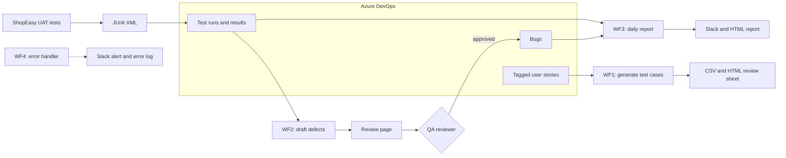

# AI UAT Assistant

An n8n and Azure DevOps setup that helps a QA team run user acceptance testing with an LLM in the loop. It turns user stories into test cases, turns failed test results into Bug drafts that a person has to approve, and sends a daily readiness report. The system under test is ShopEasy, a small fictional checkout app with three deliberate defects, so the whole flow can run end to end.

## Modules

### Sample app and tests

`shopeasy/` is a small Python checkout domain that uses `Decimal` for money. `test-plans/approved-cases-2026-10-24.csv` is the WF1 output after a QA review: each generated case is marked approved, edited, or dropped, with a note explaining the call. One AI-generated rounding case used data that could not catch a rounding bug, for example, so the reviewer changed it. `tests_shopeasy/` holds 16 UAT tests, ten of which automate approved cases and carry their case ID. Every test is linked to a story. A run produces 12 passes, 3 failures from the planted defects, and 1 blocked test. US-CHK-06 has no acceptance criteria in Azure DevOps, so it has no tests and the report lists it as untested.

### Azure DevOps scripts

`seed_ado.py` creates the fictional user stories with a `shopeasy-demo` tag and is safe to rerun. `publish_results.py` turns the JUnit XML into an Azure DevOps test run and keeps the link from each result back to its story and test case.

### Test-case generation (WF1)

WF1 reads the tagged stories and asks the LLM for test cases in a strict JSON schema. Code then checks that every acceptance criterion has at least one positive case and that the set includes negative and edge cases. A draft that fails the check gets one retry before it goes to a person. The output is a CSV and an HTML review sheet, plus a summary comment on each story. A story with no acceptance criteria gets a comment asking for them, and no cases are generated for it.

### Defect drafting (WF2)

WF2 takes the failed results from a run and skips any failure that already has an open Bug. For each new failure it asks the LLM for a Bug draft based on the error message, the stack trace, and the story's acceptance criteria, and it rejects drafts whose "actual result" doesn't match the evidence. Local file paths in stack traces are redacted. The review page shows each draft next to its story, acceptance criteria, and failed test case. A reviewer can edit the title, severity, priority, or repro steps, then approves or rejects each draft. The workflow creates Bugs only for approved drafts. Each Bug gets an evidence section with the test case ID, links to the story and the test run, and a line naming the reviewer.

### Daily report (WF3)

WF3 runs every day at 18:00 (Asia/Taipei) or on request. It pulls the latest run, the run before it, the open Bugs, and the tagged stories. All the numbers (pass rate, execution progress, per-story coverage, and GREEN/AMBER/RED readiness with its reasons) are computed in code. The LLM only writes the summary paragraph, and if that paragraph contains a number the code didn't produce, the report uses a template summary instead. The result goes to Slack and to an HTML file.

WF4 is the shared error workflow. It masks anything that looks like a credential, posts an alert to Slack if a webhook is configured, and appends the failure to a local log.

## Human in the loop

The model suggests severity and priority, but a named reviewer decides. If the reviewer field is empty, the whole review is rejected, and if nobody responds within 24 hours, no Bugs are created. Stories without acceptance criteria and LLM output that fails validation are flagged for a person rather than filled in by the model.

## Tech stack

- n8n 2.44.6 in Docker, bound to localhost
- Azure DevOps REST API (work items, WIQL, test runs)
- OpenAI chat completions with strict JSON schema output, plus a mock mode that runs the same workflows on recorded responses without calling the API
- Python standard library and Node.js built-ins only, no third-party packages
- Slack incoming webhooks (optional)

## Running it

This public version has the architecture, the workflow logic, and the tests. The n8n workflow exports, prompts, Docker setup, and setup guide aren't included. They're part of what I set up in a client's own Azure DevOps project. Send me a message if you'd like to see more of how it works.

Sample data is fictional (ShopEasy). This is a self-initiated portfolio project.

## License

Copyright © 2026 rikkadawufa. All rights reserved. No license is granted to use, copy, modify, or distribute this code.
